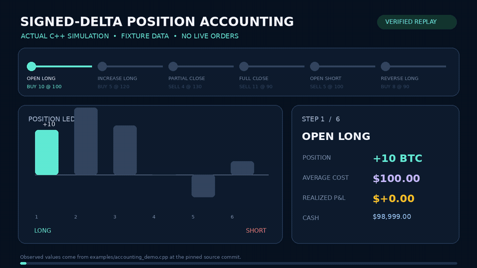

## Reproducible native validation



The demo above is generated from an actual native C++ replay: it opens and adds
to a long position, partially and fully closes it, opens a short, then crosses
through flat into a new long. The receipt, source manifest, MP4, GIF, and verifier
live in [`docs/demo`](docs/demo). Reproduce the accounting gates with
`make accounting-test`, the 68-configuration executable smoke with
`python3 scripts/backtester-e2e.py`, and the published-media proof with
`python3 scripts/verify-accounting-demo.py`.

This is deterministic simulated accounting over fixture fills. It does not place
live orders or establish profitability, execution quality, or latency.

`make all test` builds the portable C++ bridge and executes a real persisted
BayesianRidge model through the Python predictor. The gate trains a bounded
synthetic fixture, checks concurrent C++ requests against direct model predictions,
exercises paths containing spaces, and rejects missing model files. Install
`python -m pip install -r python_ml/requirements.txt` first.

The bridge defaults to real models. Mock models require an explicit flag and are
for integration fixtures; unavailable models and prediction failures now fail
rather than silently returning fabricated predictions. The Python protocol emits
one CSV result on stdout and diagnostics on stderr.

`make backtester` builds the historical event-driven C++ backtester with the
included, pinned csv2 headers. Full market history is optional Git LFS data; the
build and bridge E2E require no multi-GB download. The actual historical backtester gate completes 68 strategy/dataset
configurations on 11 generated 64-row OHLCV files:
`python3 scripts/backtester-e2e.py`. Current validation does not establish
trading profitability, full-history training, or live-order behavior.

# Financial C++/Python ML Trading System

This project implements a Bayesian machine learning trading system with a C++ trading engine and Python ML components.

## Architecture

The system consists of:

1. **Python ML Components** (`python_ml/`)
   - `bayesian_ml_engine.py`: Core ML engine with Bayesian models for uncertainty estimation
   - `ml_predictor.py`: Script for making predictions from the C++ engine
   - `mock_model.py`: Mock model for testing without real models
   - `models_test/`: Directory for trained and mock models

2. **C++ Trading Engine** (`cpp/`)
   - `ml_bridge.h` and `ml_bridge.cpp`: Bridge for calling Python ML models from C++
   - Trading decision logic based on predictions and uncertainty

## Features

- **Bayesian Uncertainty Estimation**: ML models provide both predictions and uncertainty estimates
- **Position Sizing**: Trading position sizes can be adjusted based on prediction confidence
- **Mock Mode**: Testing can be done with mock models when real models aren't available
- **Multiple Models**: Supports ensembles of different ML models (Bayesian Ridge, XGBoost, AdaBoost, neural networks)

## How It Works

1. The C++ trading engine collects market data (OHLCV)
2. The ML bridge converts the data to JSON and calls the Python predictor
3. The Python predictor loads the appropriate models and makes predictions
4. The predictor returns both prediction and uncertainty values
5. The C++ engine makes trading decisions based on the prediction/uncertainty

## Usage

### Running the Test Program

```bash
# Compile the test program
g++ -std=c++17 ml_bridge.cpp -o ml_bridge_test

# Run the test program
./ml_bridge_test
```

### Using Mock Models

To use mock models for testing:

```bash
# Create mock model files
python3 python_ml/mock_model.py --model-dir python_ml/models_test --asset btc
```

The bridge can be configured to use mock models:

```cpp
// Use mock models (set last parameter to true)
MLBridge mlBridge(pythonPath, scriptPath, modelDir, "btc", true);
```

## Debugging

- Check `python_ml/models_test/btc/` directory for model files
- Set the `--use-mock` flag when running `ml_predictor.py` directly
- Examine raw output with the detailed logging in both C++ and Python components
